# Expense Tracker

> A fast, frontend-only expense tracking web app built with **Vue 3 (Options API)**, **Vue Router 4** and **Vite**. No backend, no database, no UI library.

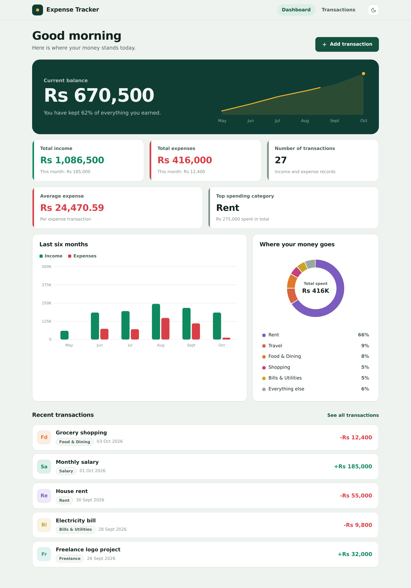

---

## Table of Contents

- [Project Description](#project-description)
- [Features](#features)
- [Screenshots](#screenshots)
- [Technologies Used](#technologies-used)
- [Project Structure](#project-structure)
- [Installation Steps](#installation-steps)
- [How to Run the Project](#how-to-run-the-project)
- [Usage](#usage)
- [Persistence](#persistence)
- [Validation Rules](#validation-rules)
- [License](#license)

---

## Project Description

**Expense Tracker** helps you record income and expenses, find any transaction quickly, and understand where your money goes. The dashboard recalculates every figure (totals, balance, averages, top category and both charts) from your saved transactions, so it is always up to date.

The project is a single-page application that runs entirely in the browser. All data is kept in the browser's `localStorage`, so it needs no server or account. Styling is hand-written CSS3 with custom properties, which gives a light and a dark theme, and a layout that adapts to desktop, tablet and mobile screens. The charts are drawn with plain SVG, with no chart library.

It was built as an intern project to practise the Vue 3 **Options API** (`data`, `props`, `computed`, `methods`, `watch`, lifecycle hooks), component design, routing, form validation and state management with a small reactive store.

---

## Features

### Transactions
- Add, edit, delete and view the details of a transaction.
- Two transaction types: **Income** and **Expense**, each with its own set of categories.
- Dedicated **details page** for every transaction, showing its category totals and its share of them.

### Dashboard (all values calculated dynamically)
- **Total Income**
- **Total Expenses**
- **Current Balance** (animated count-up with a six-month balance trend line)
- **Number of Transactions**
- **Average Expense**
- **Top spending category**
- **Monthly income vs. expense bar chart** for the last 6 months
- **Category-wise expense donut chart**

### Search, filter and sort
- **Live search** by description or category (results update as you type).
- Filter by **type**: Income / Expense / All.
- Filter by **category**.
- Sort by **Newest first**, **Oldest first**, **Highest amount** or **Lowest amount**.
- A running summary of the income and expenses of the current result set.

### User experience
- **Form validation** with clear inline error messages for description, amount, category and date.
- **Icons everywhere**: every category has its own inline-SVG icon (rows and details page), and each dashboard statistic card carries an icon badge. Icons live in `src/utils/icons.js` and render through the `AppIcon` component, so there is no icon library to install.
- **Animations and transitions**: page fade between routes, modal and toast transitions, list items that slide in and out, statistic cards that rise in one after another, hover lift on cards and rows, icon pop on hover, button press feedback, an animated balance count-up, and a shake plus slide-in message on invalid form fields. All motion is switched off for visitors who prefer reduced motion.
- **Gradient design system**: a pine-to-teal gradient (with a saffron accent) runs through the header line, active navigation, buttons, filter controls, balance hero, statistic badges and the custom dropdowns, with matching light and dark variants. The colours are CSS variables (`--grad-*`) in `src/assets/main.css`.
- **Animated buttons**: gradient shift, light sweep and lift on hover, press-down on click, a click ripple (`src/main.js`), a rotating plus icon and a growing gradient underline on text links.
- **Delete confirmation dialog** before anything is removed permanently.
- **Toast notifications** after add, update and delete.
- **Empty states** for no data, no search results and an unknown transaction.
- **Sample data loader** for first-time users, so the dashboard and charts can be explored right away.
- **Dark / Light theme toggle**, remembered between visits (and defaulting to the system preference).
- **Responsive design** for desktop, tablet and mobile (navigation moves to a bottom tab bar on small screens).
- **Data persistence** through `localStorage`: everything survives a page refresh.
- Accessible by design: labelled form fields, `aria-invalid` and `aria-live` hints, focus is moved to the first invalid field, dialogs keep keyboard focus inside while open, close on Escape and give focus back afterwards.

---

## Screenshots

### Dashboard

| Light theme | Dark theme |
| --- | --- |
|  | 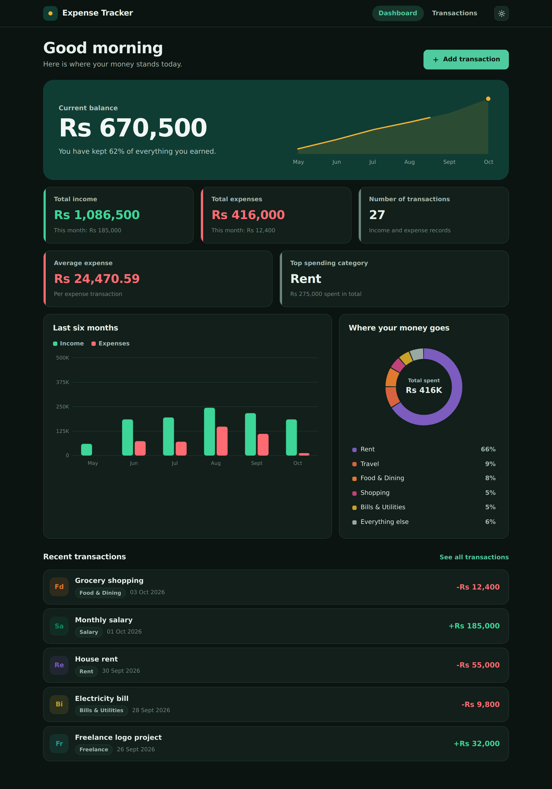 |

### Transactions: search, filter and sort

| All transactions | Expense filter, sorted by highest amount |
| --- | --- |
| 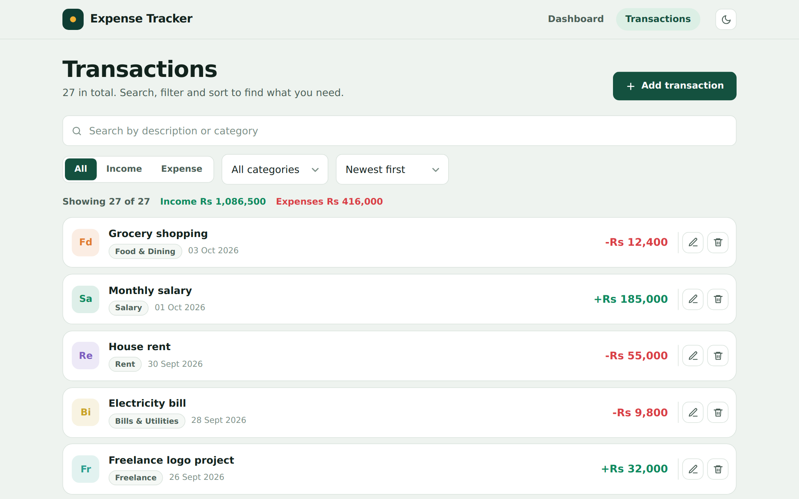 | 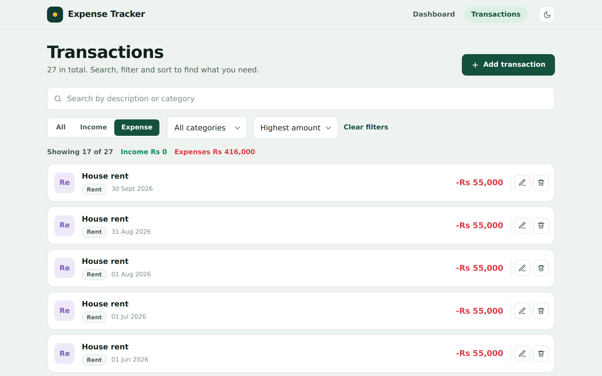 |

### Forms and dialogs

| Inline validation errors | Edit transaction |
| --- | --- |
| 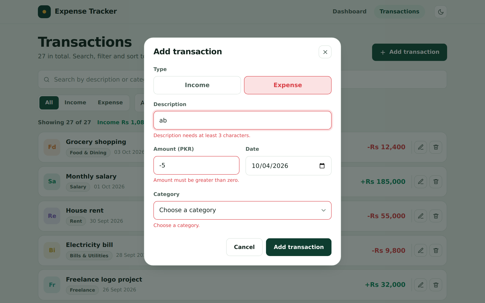 | 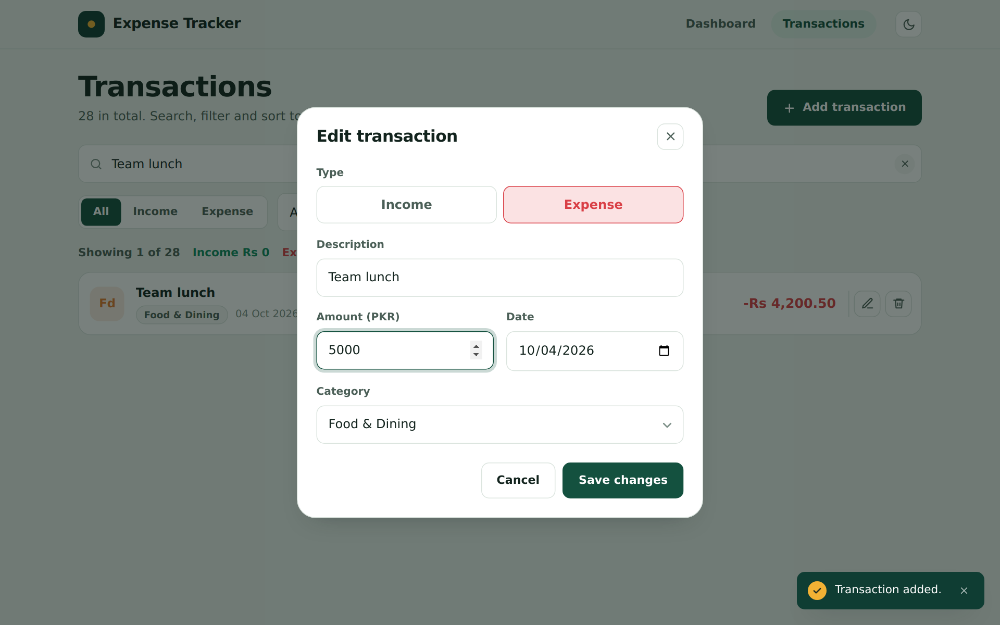 |

| Delete confirmation | Toast notification |
| --- | --- |
| 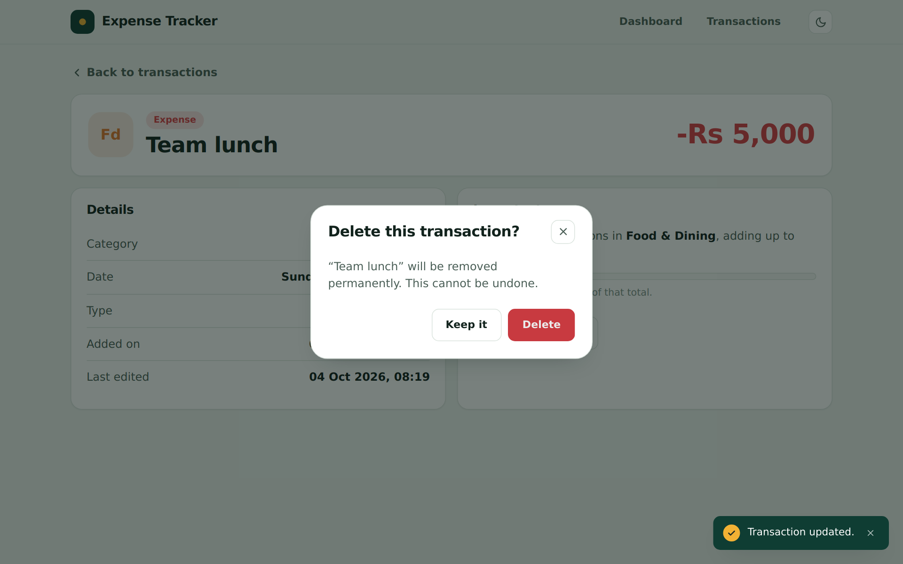 | 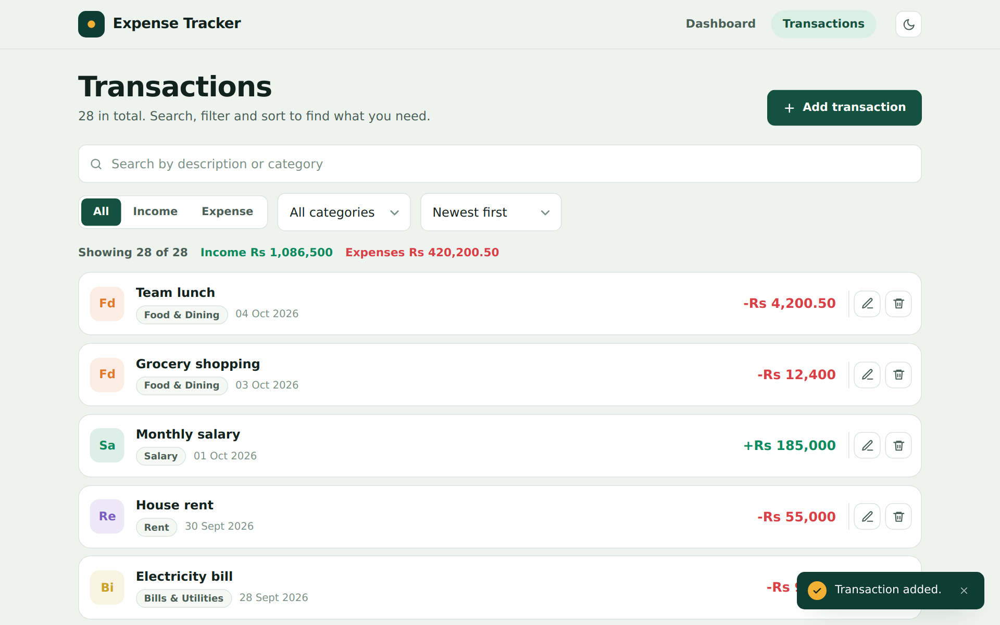 |

### Details and empty states

| Transaction details | First visit (sample data loader) |
| --- | --- |
| 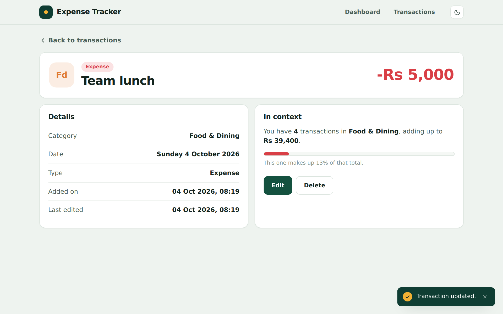 | 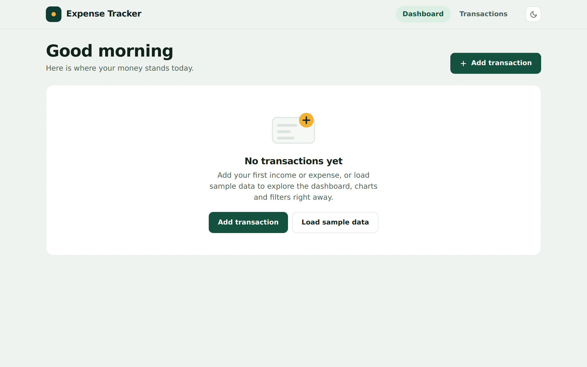 |

| No search results |
| --- |
| 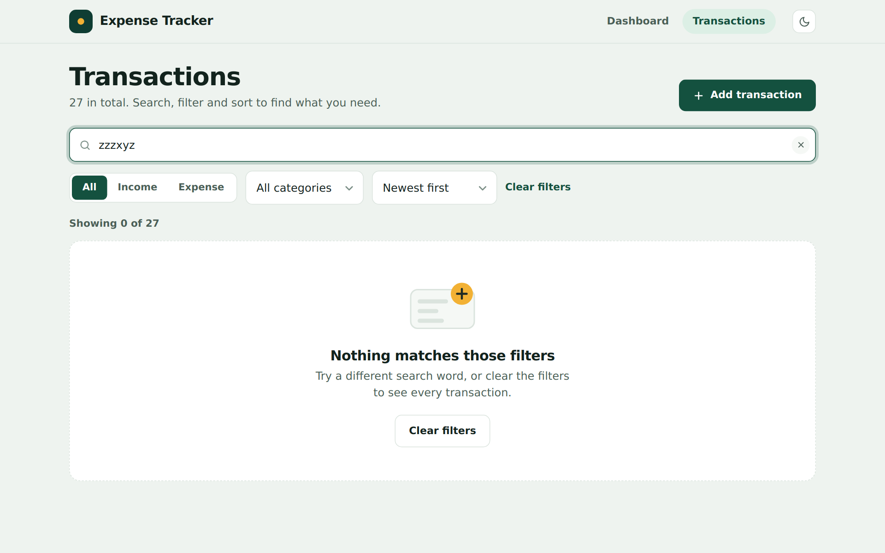 |

### Responsive design

| Tablet | Mobile: dashboard | Mobile: charts | Mobile: transactions |
| --- | --- | --- | --- |
| 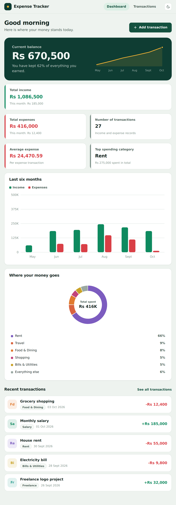 | 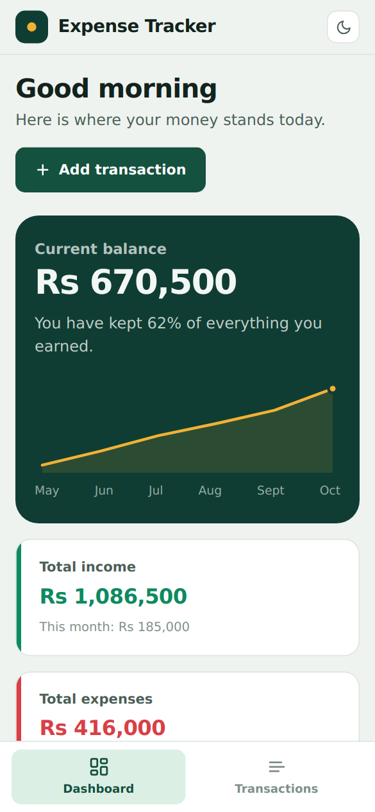 | 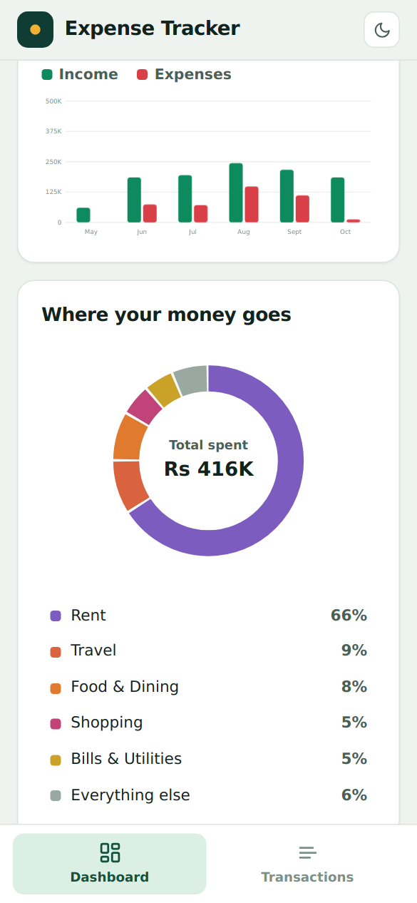 | 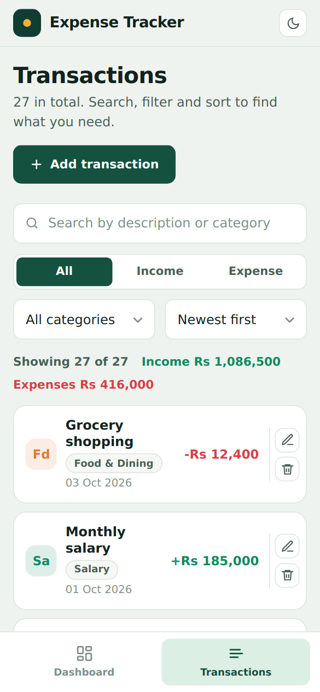 |

---

## Technologies Used

| Technology | Purpose |
| --- | --- |
| **Vue 3** (Options API, composition through a reactive store) | UI components and reactivity |
| **Vue Router 4** (hash history) | Navigation between Dashboard, Transactions and Details |
| **Vite 5** | Dev server and production build |
| **CSS3** (custom properties, media queries, dark mode) | Styling, theming and responsive layout |
| **localStorage** (Web Storage API) | Saving transactions and the chosen theme |
| **SVG** | Hand-built donut chart, bar chart and trend line |

No external UI library and no chart library are used.

### Vue concepts demonstrated

| Concept | Where |
| --- | --- |
| Components and props | `TransactionCard`, `StatCard`, `FilterBar`, `DonutChart`, `MonthlyChart` |
| Custom events (`emits`) | `TransactionCard`, `TransactionForm`, `ModalDialog`, `ConfirmDialog` |
| `v-model` (including `v-model:type`, `v-model:sort`) | `SearchBar`, `FilterBar`, `TransactionForm` |
| `v-for`, `v-if` / `v-else` | Lists, empty states, form errors |
| Computed properties | Totals, balance, filtered and sorted list, chart data |
| Watchers | Theme switching, category reset when the type changes, balance animation |
| Lifecycle hooks | `created`, `mounted`, `beforeUnmount` in dialogs, form and views |
| Reactive store | `reactive()` state, getters and actions in `store/transactionStore.js` |
| Routing | Static and lazy-loaded routes, route params (`/transactions/:id`), query flag |

---

## Project Structure

```
expense-tracker/
├── docs/screenshots/            Screenshots used in this README
├── index.html
├── vite.config.js
├── package.json
└── src/
    ├── assets/main.css          Design tokens (CSS variables), light/dark themes, shared styles
    ├── components/
    │   ├── AppHeader.vue        Header, navigation, theme toggle
    │   ├── AppIcon.vue          Inline SVG icon renderer (name -> icon)
    │   ├── BalanceHero.vue      Current balance, count-up animation, trend line
    │   ├── ConfirmDialog.vue    Delete confirmation
    │   ├── CustomSelect.vue     Accessible gradient dropdown (opens downward, flips only when needed)
    │   ├── DashboardStats.vue   Balance hero plus the statistic cards
    │   ├── DonutChart.vue       Expenses by category
    │   ├── EmptyState.vue       Reusable empty state
    │   ├── FilterBar.vue        Type, category and sort controls
    │   ├── ModalDialog.vue      Reusable accessible dialog
    │   ├── MonthlyChart.vue     Income vs. expense for the last 6 months
    │   ├── SearchBar.vue        Live search input
    │   ├── StatCard.vue         A single statistic
    │   ├── ToastContainer.vue   Success messages
    │   ├── TransactionCard.vue  One transaction row
    │   └── TransactionForm.vue  Add / edit form with validation
    ├── router/index.js          Routes (hash history)
    ├── store/
    │   ├── transactionStore.js  Reactive state, getters, actions, localStorage persistence
    │   ├── toastStore.js        Toast messages
    │   └── sampleData.js        Sample transactions for first-time users
    ├── utils/
    │   ├── constants.js         Types, categories, colours, icons, sort options
    │   ├── format.js            Currency and date formatting helpers
    │   └── icons.js             Inline SVG icon bodies used by AppIcon
    ├── views/
    │   ├── Dashboard.vue        Statistics, charts and recent transactions
    │   ├── Transactions.vue     List with search, filters and sorting
    │   └── Details.vue          Single transaction details, edit and delete
    ├── App.vue
    └── main.js
```

---

## Installation Steps

**Prerequisites:** [Node.js](https://nodejs.org/) 18 or newer and npm (bundled with Node.js).

1. **Get the project** (clone the repository or unzip the downloaded archive):

   ```bash
   git clone <your-repository-url>
   cd expense-tracker
   ```

2. **Install the dependencies:**

   ```bash
   npm install
   ```

---

## How to Run the Project

**Start the development server** (with hot reload):

```bash
npm run dev
```

Open the address printed in the terminal, usually <http://localhost:5173>.

**Create a production build** (output goes to `dist/`):

```bash
npm run build
```

**Preview the production build locally:**

```bash
npm run preview
```

| Script | What it does |
| --- | --- |
| `npm run dev` | Starts the Vite dev server |
| `npm run build` | Builds the app for production into `dist/` |
| `npm run preview` | Serves the production build locally |

Because the app uses hash-based routing (`/#/transactions`), the `dist/` folder can be hosted on any static host (GitHub Pages, Netlify, Vercel, ...) without extra server configuration.

---

## Usage

### First launch
A brand-new visitor sees an empty state. Choose **Add transaction** to start from scratch, or **Load sample data** to fill the app with realistic example transactions and explore the dashboard, charts, search and filters immediately.

### Add a transaction
1. Click **Add transaction** (on the Dashboard or the Transactions page).
2. Choose the **Type**: Income or Expense.
3. Enter a **Description**, an **Amount** (PKR), a **Date** and a **Category** (the category list depends on the type).
4. Click **Add transaction**. Invalid fields show an inline message and nothing is saved until they are fixed.
5. A toast confirms the new transaction, and the dashboard figures update straight away.

### Edit a transaction
1. On the **Transactions** page, click the pencil icon on a row (or open the row and click **Edit** on the details page).
2. Change any field in the pre-filled form.
3. Click **Save changes**. A toast confirms the update.

### Delete a transaction
1. Click the trash icon on a row (or **Delete** on the details page).
2. A confirmation dialog asks whether to remove it permanently.
3. Click **Delete** to confirm, or **Keep it** to cancel. A toast confirms the deletion.

### View details
Click any transaction to open its details page: type, category, full date, when it was added and last edited, and how it fits into its category.

### Search, filter and sort
- Type in the search box to match descriptions or categories as you type.
- Use the **All / Income / Expense** switch and the **category** dropdown to narrow the list.
- Choose **Newest first**, **Oldest first**, **Highest amount** or **Lowest amount** to sort.
- Click **Clear filters** to start over.

### Switch theme
Use the sun / moon button in the header. The choice is remembered.

---

## Persistence

All data is stored **locally in your browser** using the Web Storage API (`localStorage`). There is no backend and no database, and nothing is ever sent over the network.

| Key | Contents |
| --- | --- |
| `expense-tracker:transactions` | JSON array of all transactions |
| `expense-tracker:theme` | `light` or `dark` |

- Data is written after every add, edit and delete, and read again when the app starts, so it **survives page refreshes** and browser restarts.
- Data belongs to one browser profile on one device. It is not shared between browsers or devices.
- Clearing the site data (or using a private window) removes it.
- Stored records are validated when they are loaded, so a corrupted entry cannot break the app.

---

## Validation Rules

| Field | Rule |
| --- | --- |
| Description | Required, 3 to 60 characters |
| Amount | Required, a number greater than 0, at most two decimals, at most 100,000,000 |
| Category | Required, must match the selected type |
| Date | Required, valid, not in the future, not before 2000-01-01 |

---

## License

This project is released under the **MIT License** (see the [`LICENSE`](LICENSE) file) and is intended for educational purposes.
